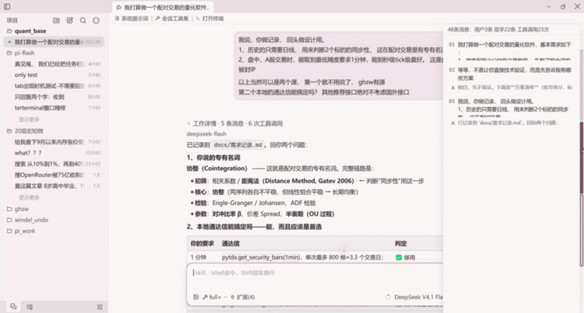

<p align="left"></p>

Pi Flash ： Windows上的极速 Pi coding agent！



▶ 同款演示另有**带音轨完整版**（17s mp4）：[docs/images/pf-intro.mp4](docs/images/pf-intro.mp4)

```bash
npm install -g pi-flash@latest   # 安装与更新
pi-flash                                # 启动
```
需要 Node.js ≥ 22.19
> 平台范围：**仅 Windows x64**

## 许可证
本项目以 **GPL-3.0-or-later** 许可证发布（见 [LICENSE](LICENSE)），继承自Zed项目。
你可以自由使用、修改、分发本软件，但任何基于本软件的衍生作品**必须**以GPL-3.0-or-later 开源。
不接受未经 Copyright Holder 同意的闭源分发。

第三方组件的版权与许可证声明见[THIRD-PARTY-NOTICES.md](THIRD-PARTY-NOTICES.md)。
